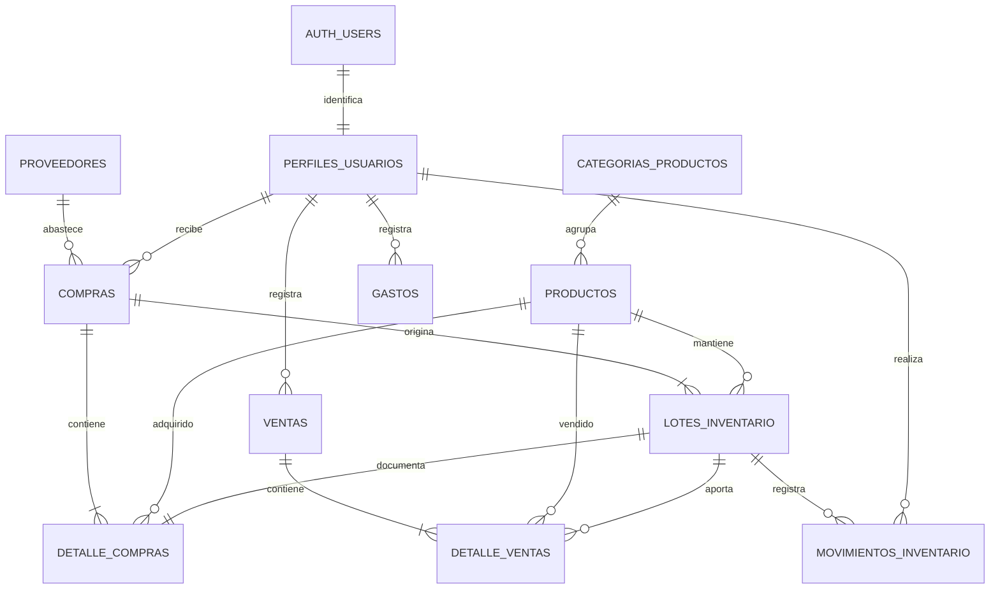

# Modelo relacional para revisión docente

Sistema web inteligente para la gestión de ventas e inventario de galletas nutritivas. Programación III e Investigación Operativa II, UNIFRANZ. Modelo inicial: 8 entidades principales, 3 tablas operativas de apoyo y tablas privadas de seguridad.

**Por validar con la docente:** se interpreta «8 módulos o tablas madre» como ocho entidades principales con gestión funcional. Compras y ventas son cabeceras de operaciones, no tablas maestras en sentido estricto. Si se exige ocho catálogos maestros, hay que aclarar el criterio antes de alterar el diseño. No se agregan tablas artificiales para completar el número.

## Diagrama

## Ocho entidades principales

| Módulo / tabla | Clave primaria | Relaciones y datos principales |
|---|---|---|
| Usuarios / `perfiles_usuarios` | `id` UUID de Auth | Nombre, correo único, rol, activo. Sin contraseña. |
| Categorías / `categorias_productos` | `id` UUID | Nombre único, descripción, activo. |
| Productos / `productos` | `id` UUID | `categoria_id`, código único, nombre, presentación, precio de venta, mínimo manual, activo. |
| Proveedores / `proveedores` | `id` UUID | Nombre, contacto, teléfono como texto, dirección, activo. |
| Compras / `compras` | `id` UUID | `proveedor_id`, `usuario_id`, fecha, total, observación. Mercadería recibida. |
| Lotes / `lotes_inventario` | `id` UUID | `producto_id`, `compra_id`, código por producto, cantidad inicial/disponible, costo unitario, vencimiento. |
| Ventas / `ventas` | `id` UUID | Número interno, `usuario_id`, fecha, método de pago, total y costo histórico total. |
| Gastos / `gastos` | `id` UUID | `usuario_id`, concepto, categoría, monto, fecha y observación. |

Posible distribución por integrante: usuarios/categorías, productos/proveedores, compras/lotes y ventas/gastos. Es una propuesta de responsabilidad, no una separación de permisos ni de bases de datos.

## Tablas de apoyo

- `detalle_compras`: una línea por lote recibido, con producto, cantidad y costo. La interfaz recibe un lote por operación; la estructura admite compras de varias líneas.
- `detalle_ventas`: una línea por lote consumido. Una misma galleta puede consumir dos lotes y conservar dos costos de compra diferentes.
- `movimientos_inventario`: entradas y salidas, usuario, fecha y referencia a la operación. La interfaz no permite cambiar saldos directamente.
- `auth.users`: credenciales administradas por Supabase Auth. Su esquema interno no se expone en el cliente.
- Esquema `private`: sesiones autorizadas, contadores de intentos, auditoría de accesos y permisos de recuperación de un solo uso. No es accesible a empleados mediante la API.

## Reglas de integridad

1. Montos `numeric`, cantidades enteras, claves UUID, nombres `snake_case` sin tildes ni espacios. Fechas de operación `timestamptz`; vencimientos `date`.
2. Una venta conserva el precio y costo al momento de la operación. Cambiar el precio actual no modifica el historial.
3. Compra, lote, detalle y entrada se guardan juntos. Venta, detalles, saldos y salidas se guardan juntos, dentro de una transacción.
4. Las ventas bloquean las filas de producto en orden estable y consumen lotes por vencimiento. No se puede vender un producto inactivo, vencido o sin suficientes existencias.
5. No hay borrado directo de productos/usuarios con historia; se desactivan. La aplicación no permite editar ventas ni costos históricos.
6. El stock vendible es la suma de lotes con vencimiento igual o posterior a la fecha local de La Paz. Las existencias vencidas se conservan para control y quedan excluidas de ventas.
7. Ingresos menos costo de lo vendido = ganancia bruta. Ganancia bruta menos gastos operativos = resultado neto estimado. Las compras de stock no se descuentan otra vez como gasto operativo.

## Preparación para IO y la IA

El historial de ventas, cantidades, lotes, costos y fechas servirá como fuente para cobertura, ABC, márgenes, productos estancados, alertas y reportes semanales. Los costos por pedido, mantenimiento, tiempos de entrega y parámetros del EOQ se incorporarán en el sprint 3 mediante una migración adicional. No se calculan ni se almacenan predicciones ficticias en esta entrega.

El asistente futuro utilizará consultas autorizadas y resultados calculados, con el número/correo del administrador. No necesita acceso público a la BD ni claves de servicio en el navegador. Su integración concreta se hará en el sprint 4.

Definición exacta de columnas, tipos, restricciones y políticas: `supabase/001_schema.sql`. Este modelo se prepara para que el usuario lo remita a la docente; no se ha enviado.
